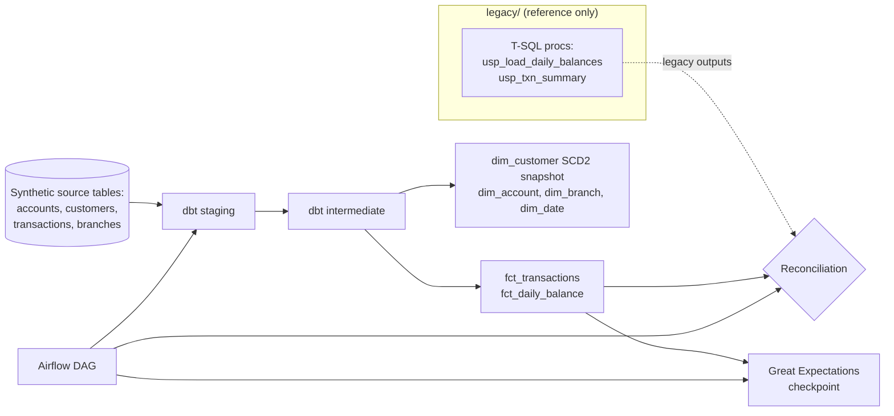

# sqlserver-to-snowflake-dbt-migration

[](https://github.com/navyaajs-web/sqlserver-to-snowflake-dbt-migration/actions/workflows/ci.yml)


A worked migration of a fictional retail bank's reporting logic, **Harbor Point Bank**, from SQL Server stored procedures (the kind SSIS packages call) into dbt. Apache Airflow orchestrates the run. dbt tests, model contracts and Great Expectations check the data, and a reconciliation step proves the new outputs match the legacy ones.

It runs locally on DuckDB. The same models have Snowflake and Redshift profiles.

## Problem
Legacy reporting lives in stored procedures and SSIS packages:
- It is hard to test.
- Its lineage is invisible.
- It is risky to change.

A migration has to deliver three things:
- Readable, tested models.
- A clean star schema.
- Evidence that the numbers did not move.

## Architecture


## Run it in three commands
```bash
make setup     # creates a venv and installs dbt-duckdb, Airflow (standalone) and Great Expectations
make seed      # generates synthetic bank data and legacy outputs into DuckDB
make run       # dbt build (models + tests + snapshots), then GE checkpoint, then reconciliation
```
`make airflow` starts Airflow standalone with the `bank_reporting_daily` DAG to show orchestration.

## What is inside
| Path | What it does |
|---|---|
| `legacy/` | The original T-SQL procedures being replaced, kept for reference and annotated |
| `datagen/` | Synthetic source generator (CSV landing files → DuckDB `raw`) and the runner for the translated legacy procedures |
| `dbt/models/staging/` | One model per source, with renames and types only |
| `dbt/models/intermediate/` | Legacy business rules (posting status, 20:00 business-day cut-off, signed amounts) defined once |
| `dbt/models/marts/` | Star schema with enforced model contracts |
| `dbt/snapshots/` | `dim_customer` SCD2 |
| `dbt/tests/` | Generic and singular tests (balance never negative for savings, FK integrity) |
| `great_expectations/` | Checkpoint on `fct_transactions` (volume, distribution, freshness) |
| `reconcile/` | Python job comparing legacy vs dbt outputs on row counts, sums by key and sampled rows |
| `airflow/dags/` | DAG: dbt build → GE → reconcile, with retries and an SLA (an Airflow 3 deadline alert) |
| `profiles/` | DuckDB (default), Snowflake and Redshift targets read from env vars (`.env.example`) |
| `docs/migration-notes.md` | Proc-to-model mapping, dialect mapping, test layers, reconciliation and Airflow notes |

## Tests
```bash
make test     # pytest (reconcile, generator, DAG parse) + dbt build --select test_type:data
```

## What this proves
- I can migrate legacy SQL Server/SSIS reporting logic to dbt.
- I can model a star schema with SCD2.
- I can enforce contracts and tests.
- I can prove parity with an automated reconciliation before cut-over.

## Limitations
- The legacy procedures are run as translated SQL in DuckDB, not on a real SQL Server, so dialect conversion is shown by side-by-side comments.
- Snowflake and Redshift targets are configured but not exercised in CI (no credentials).

## About the author
Built by Navya Sindhu, Senior Data Engineer. [LinkedIn](https://www.linkedin.com/in/navyaajs/). This is a personal project with synthetic data and a fictional bank. It contains no employer or client code, schemas or data.
